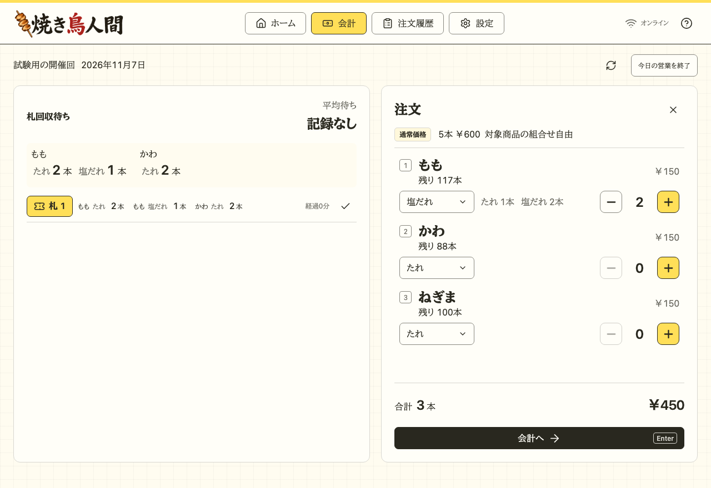
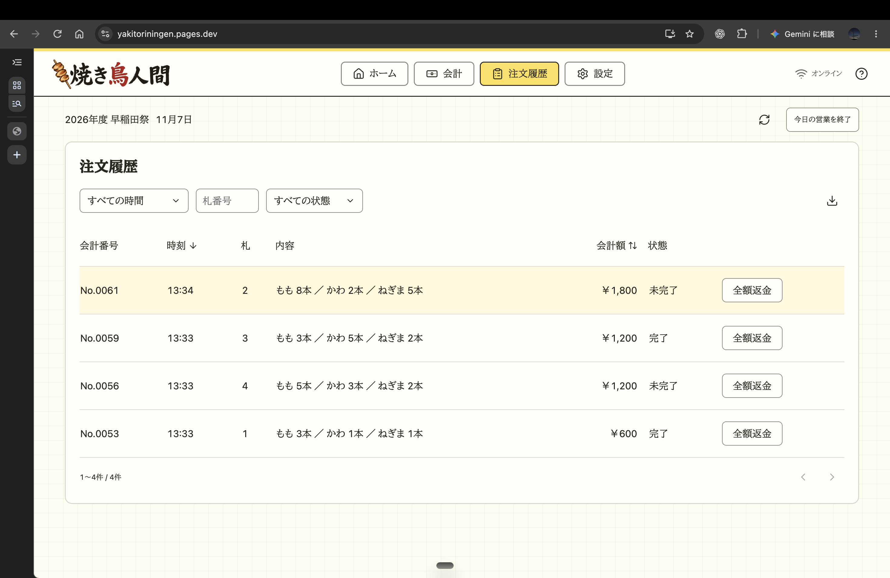
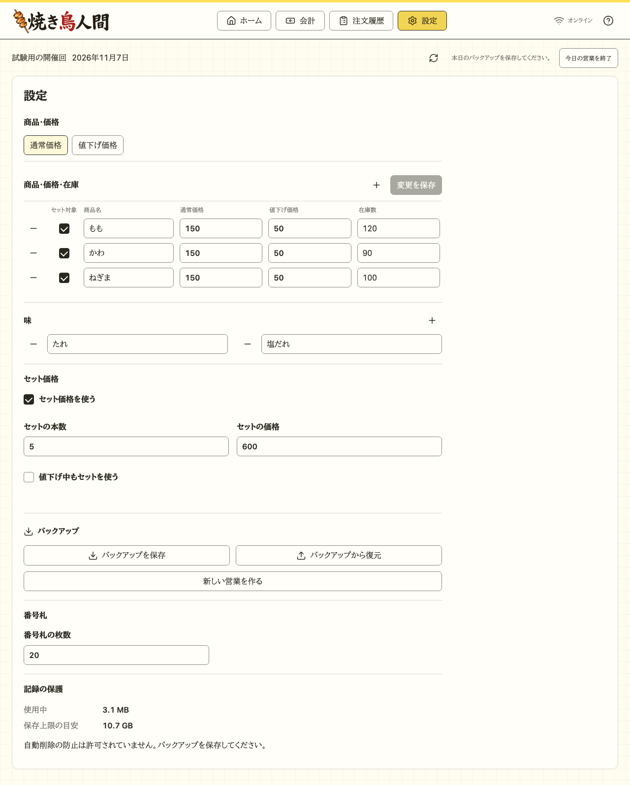
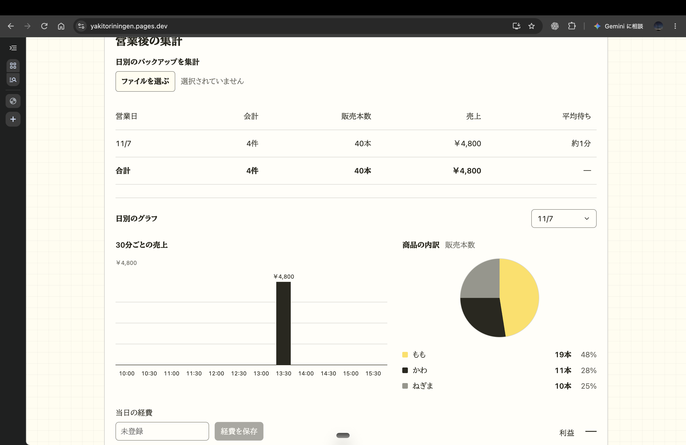

# 焼き鳥人間

WASAが早稲田祭で出店する焼き鳥屋「焼き鳥人間」の会計アプリです。

PC1台で注文受付・現金会計・受け渡し・売上確認ができます。事前に準備すれば、営業中は通信なしで使えます。

[アプリを開く](https://yakitoriningen.pages.dev)

## 使い方

### 会計担当者向け

右側で商品の味を選び、本数を入力し、整理券を割り当てます。（お釣りは自動計算されます）

左側で、現在の注文状況・待ち時間などを確認することができます。（待ち時間は会計確定から、整理券が返却されるまでの時間で計算しています）

整理券が返却されたら、左側のチェックボタンを押します。



注文履歴画面では、過去の注文状況を調べることができます。ソートやフィルタリングにも対応しています。調べたい行をクリックすると、注文の詳細情報を確認することができます。



設定画面では、メニューや味の追加・変更・削除、価格・在庫の変更ができます。



### 責任者向け

#### 営業開始前

ホームの「営業を準備」（初回）または「新しい営業を作る」から、営業名・日付・商品・価格・任意の在庫を登録します。日付を確認して「会計を始める」を押してください。

営業名はホームの鉛筆アイコンで変更できます。名前は営業日ごとに保存され、前日の記録も残ります。

#### 営業終了後

1日の営業が終了したら、右上にある「今日の営業を終了」ボタンを押してください。

表示された販売本数と売上を確認し、「JSON・CSVを保存」を押します。バックアップ（.json）と注文履歴（.csv）の両方が保存されたことを確認して終了してください。

集計をしたい際は、ホーム画面に戻り、「営業後の集計」ボタンを押したのち、対象日のバックアップファイル（.json）をアップロードすると、集計のダッシュボードを開くことができます。



## 開発・起動

ここからは開発者向けです。

Node.js 22.12以上とnpmを使います。

```sh
npm ci
npm run dev
```

表示されたURLをブラウザで開きます。オフライン動作は、本番ビルドで確認します。

```sh
npm run build
npm run preview
```

プレビューは `http://127.0.0.1:4173` で開けます。検証コマンドと開発ルールは[開発への参加](CONTRIBUTING.md)を参照してください。

`main`へpushするとGitHub Actionsが検証し、成功したビルドをCloudflare Pagesへ自動公開します。

## ドキュメント

- [公開と更新](docs/deployment.md)：Cloudflareへの公開とデータの引き継ぎ
- [要件定義書](docs/requirements.md)：機能と運用の条件
- [全体アーキテクチャ](docs/architecture.md)：構成とデータの流れ
- [フロントエンド](docs/frontend.md)：画面と入力状態の扱い
- [バックエンド相当の処理](docs/backend.md)：ブラウザ内の業務処理と保存
- [開発への参加](CONTRIBUTING.md)：変更・検証・Gitのルール

記録は使用中のPC・ブラウザに保存され、クラウドへ同期しません。ブラウザデータの削除やPC故障に備え、バックアップを別媒体にも保存してください。公開・更新は[Cloudflareの手順](docs/deployment.md)を参照してください。

[MIT License](LICENSE)
