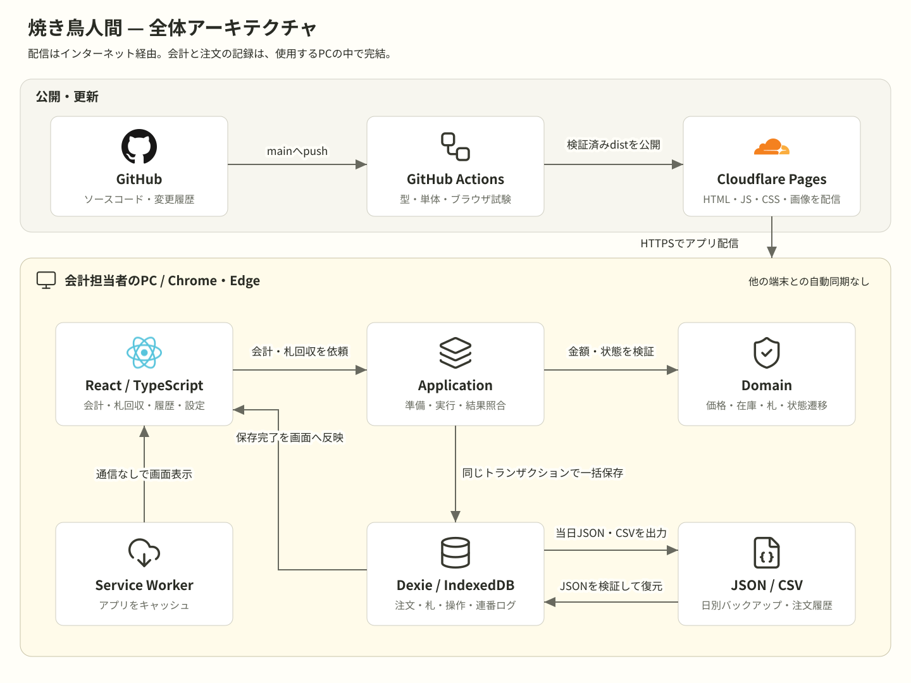
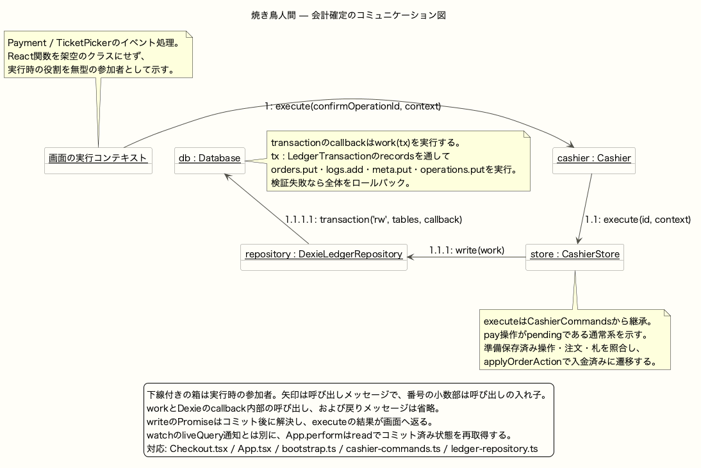

# 全体アーキテクチャ

PC1台で使うオフライン対応のWebアプリです。React・TypeScript・Viteで画面を作り、業務処理も保存もブラウザ内で実行します。サーバー側のAPI・DB・認証はありません。

## 構成



SVGは拡大して読めます。[PNG版](images/architecture.png)も用意しています。アイコンの下にサービス・概念名を、矢印に処理名を記載しています。注文データの処理と保存はPC内で完結します。

配信は初回準備とアプリ更新に使用します。Cloudflare Pagesで`dist/`を配信し、サーバー側の実行処理やDBは追加しません。公開・更新は[デプロイ手順](deployment.md)を参照してください。営業中に注文や経費を配信元へ送信する処理はありません。

## 責務と依存

| 場所 | 責務 |
|---|---|
| `src/components/`、`src/App.tsx` | 表示、入力状態、画面切り替え。操作は`Cashier`ポートへ渡す |
| `src/hooks/` | 二重起動の抑止、アプリ更新、通信状態、離脱確認などブラウザの機能 |
| `src/presentation/` | 金額・日時・会計番号の表示形式、CSV出力、エラー文、編集フォームと業務データの変換 |
| `src/application/` | 操作の準備・実行・照合・復元、保存ポート、バックアップの整合性検証 |
| `src/domain/` | 型・入力制約・上限値、価格計算、注文と札の状態遷移、履歴の絞り込み、売上集計 |
| `src/storage/` | IndexedDBのトランザクション、DB定義 |
| `src/bootstrap.ts` | DB・ID生成・時刻・購読を接続する組み立て場所 |

DDDとクリーンアーキテクチャの考え方に沿い、依存を内側へ向けます。domainはReact・Dexieを参照せず、applicationは保存先の具体実装を参照しません。画面もDBを直接更新しません。詳細は[フロントエンド](frontend.md)と[バックエンド相当の処理](backend.md)を参照してください。

## サーバーを分けない理由

現在の要件は、PC1台で営業中も通信に頼らずに使えることです。有料サービスやクラウドDBも使いません。このため、業務処理と保存はブラウザ内で実行します。サーバーを追加すると通信障害への対応・認証・運用費用が必要になり、サーバーを置くだけで記録の確実性が上がるわけでもありません。

業務処理はapplication・domainに分けてあるため、画面から独立して試験できます。

将来、保存先を変更する場合は`application/ports.ts`の`LedgerRepository`や`Cashier`と`src/bootstrap.ts`が接続の境界になります。複数端末の同時利用を追加する際は、同期・競合・認証・切断時の扱いを別途設計します。アダプターの差し替えだけで端末間同期が実現するわけではありません。

## 会計のデータフロー

1. 商品を最初に入力した時点の価格を、画面の下書きへ固定する。
2. 「会計へ」で注文と札割り当てを保存する。この時点では未入金で、売上に含めない。
3. お預かり金額を入力し、確定する操作を先に保存する。
4. 現金を確認して「会計を確定」を押し、開いたダイアログで札を確認・選択して「この札で確定」する。保存時に金額・札の所有者・DB世代を検証する。
5. 注文・札・操作結果・連番ログを同時に保存し、成功後に画面へ反映する。

受け渡しと札回収も一度の操作で保存します。完了の取り消しは、対象の札が次の注文に一度も再利用されていない場合に限ります。操作や価格の履歴は残します。

## データの識別

| 識別子 | 用途 |
|---|---|
| 注文ID | 一つの注文を一意に識別。再利用しない |
| 札番号 | 実物の番号札。回収後に再利用する |
| 割り当てID | 札をその注文へ渡した一回の割り当てを識別 |
| 操作ID | 保存・再試行・結果照合を同じ処理として扱う |
| DB識別子・復元世代 | 保存先の取り違えと、復元前の古い操作を防ぐ |
| ログ連番 | PCの時計とは別に、保存された操作順を示す |

同じ操作ID・同じ内容の再試行は既存結果を返します。同じIDで内容を変えた操作、古い世代、別注文が所有する札への操作は拒否します。画面の連打防止やWeb Locksによる二重起動抑止に加え、保存層でも検証します。

## 価格と過去の記録

商品ごとにID・名前・通常価格・値下げ価格を持ちます。セットは対象商品・本数・価格を設定し、対象商品を組合せ自由でまとめた最安額を計算します。単品合計より高くなるセットは使いません。

注文には商品名・数量・味別本数・価格設定・計算結果を保存します。味名も価格版に含め、過去の注文を現在の設定から作り直しません。商品を削除したり価格を変えたりしても、入力中・会計済みの記録は当時の内容を保持します。旧形式の価格は互換処理で読み、保存済み記録を書き換えて新形式に揃える方式は使いません。

## オフライン・保存・復元

- Service Workerがアプリ本体を保存し、IndexedDBが業務データを保持する。開発サーバーではPWAキャッシュを有効にしない。
- Dexieは`cache: 'disabled'`と`chromeTransactionDurability: 'strict'`を指定する。コミット前の状態を保存済みとして表示しない。
- データはURLのオリジンとブラウザのプロファイルに結び付く。別PCへはJSONバックアップで引き継ぐ。
- JSONは全ストアを同じ時点で読み取り、当日分を抽出する。復元時はファイルの整合性と、プレビュー後にDBが変わっていないことを検証する。対象日と保持する別日の記録を統合し、新しい世代とともに一括で反映する。
- 更新は入力中・保存中・保留の操作と未保存の設定を解消してから行う。保存データは残し、更新のためのバックアップ再選択は求めない。

ブラウザの自動削除を防ぐ保護設定は`useStorageProtection`が自動で要求します。営業記録の作成後または既存記録の起動時に確認し、許可されない場合も会計を続けられます。

strict指定や永続ストレージの要求は、ブラウザデータの削除・停電・PC故障への無条件の保証ではありません。本番利用前の実機確認とバックアップ運用は[要件と受入条件](requirements.md)・[フロントエンドの利用手順](frontend.md#利用手順と復旧)にまとめています。

## 営業日と集計データ

営業日・在庫・札回収までの時間の業務ルールは、それぞれ`domain/day.ts`・`domain/inventory.ts`・`domain/wait-time.ts`に置きます。画面と保存直前の検証は同じルールを使い、書き込みは`Cashier`ポート経由で一括実行します。時計・ブラウザの状態は画面またはbootstrapから渡し、domain内で現在時刻を取得しません。

複数バックアップから作る集計データは、注文・操作・ログを含む読み取り専用のデータです。完全な`Snapshot`とは型を分け、集計結果を誤って復元処理へ渡せないようにしています。

商品編集フォームは`MenuFields`、キーボード操作は`useCheckoutKeys`を共用します。保存済みコマンド名と既存バックアップの形式は維持します。

復元対象日の選別・統合は`application/restore.ts`に集約します。ログの会計番号を振り直さず、番号の衝突と別日の未解決作業を検証します。

営業日の準備・再開ルールと在庫差分・経過時間の計算はdomain、保存を伴う実行は`CashierCommands`、入力は`DaySetup`と`MenuSettings`が担当します。

`BackupHistory`は保存確認、`DraftCache`は注文下書きを扱い、どちらも営業記録とは独立したポートです。localStorageアダプターもbootstrapで組み立てます。画面はIndexedDBとlocalStorageの具体実装を参照しません。

ダウンロード処理は`App`から画面へ渡し、`CloseDay`と`DataPanel`で共用します。

## ホームと終了時の出力

ホームを営業準備・再開・集計の入口とします。ロゴと中央のホーム操作は同じ遷移を使い、会計・設定・集計の未保存入力を保護します。営業後の集計は必要になるまで遅延読込します。

営業終了のJSON・CSVは一度読み取った同じSnapshotから当日分を生成します。設定のJSON保存、履歴の絞り込みCSVとは用途を分け、終了直前にDB識別子・世代・日付・連番と未解決作業を再確認します。保存確認は利用者の申告であり、物理ファイルの確認をブラウザが自動検出するものではありません。

## UMLと実装の対応

UMLは業務の流れとコードの関係を確認するために使います。実在するクラス、TypeScriptのデータ型、実行時のオブジェクトを図ごとに分けています。

| 図 | 確認する内容 | 対応する主な実装 | 編集元 |
|---|---|---|---|
| [ユースケース図](images/use-cases.png) | 担当者が行う営業準備・会計・回収・保存・集計 | `App.tsx`、`components/` | [use-cases.puml](diagrams/use-cases.puml) |
| [コミュニケーション図](images/communication.png) | 会計確定時のオブジェクト間の呼び出し | `Checkout.tsx`、`bootstrap.ts`、`cashier-commands.ts`、`ledger-repository.ts` | [communication.puml](diagrams/communication.puml) |
| [会計のアクティビティ図](images/checkout.png) | 入力・現金確認・札選択・確定の通常手順 | `Checkout.tsx`内の`Payment`、`TicketPicker.tsx` | [checkout.puml](diagrams/checkout.puml) |
| [営業日のアクティビティ図](images/business-day.png) | 初回準備・再開・営業終了・バックアップ | `App.tsx`、`DaySetup.tsx`、`CloseDay.tsx` | [business-day.puml](diagrams/business-day.puml) |
| [クラス図](images/classes.png) | クラスの継承、ポートの実装、保存先への参照 | `ports.ts`、`cashier-commands.ts`、`storage/` | [classes.puml](diagrams/classes.puml) |
| [データ型の関係図](images/data-model.png) | 注文・札・価格・操作・ログの多重度 | `domain/model.ts` | [data-model.puml](diagrams/data-model.puml) |



### 図の読み方

[OMG UML 2.5.1](https://www.omg.org/spec/UML/2.5.1/About-UML/)を参照し、次の記法を使っています。PlantUMLの構文検査に加え、矢印・多重度・処理順を実装と照合しています。図では補助処理やエラー分岐の一部を省略し、省略した範囲を注記しています。

- クラス図の`+`はpublic、`-`はprivate、`{readOnly}`はreadonly属性を表す。白三角の実線は継承、破線はinterfaceの実現を示す。
- 関連の多重度`1`は一つ、`0..*`はゼロ個以上を表す。型への依存やメソッド呼び出しには、インスタンス間の関連を示す多重度を付けない。
- コミュニケーション図の下線付きの箱は実行時の参加者を表す。メッセージ番号`1.1`・`1.1.1`は呼び出しの入れ子を示す。
- ユースケース図の`include`は、その機能の実行に含まれる処理を示す。操作順はアクティビティ図で示す。
- アクティビティ図は条件分岐と繰り返しを表す。現在の営業日を画面で開く操作と、保存を伴う別日の準備・再開を区別する。

### オブジェクト指向とカプセル化

アプリケーション層はクラスとinterface、ドメイン層はデータ型と純粋関数を組み合わせた設計です。すべてのデータをEntityクラスにする方針ではありません。`Order`などは公開された値の型であり、状態遷移は`applyOrderAction`で検証して新しい値を返します。

`CashierCommands`は保存ポート・ID生成・時計をprivateなreadonly参照として保持します。`CashierStore`はDBへの公開属性を持たず、`DexieLedgerRepository`が具体的なDBを内部で扱います。画面は`Cashier`ポートだけを使います。これらのprivate指定はTypeScriptのアクセス制御であり、JavaScript実行時のセキュリティ境界ではありません。

`bootstrap.ts`の`cashier`オブジェクトが構造的に`Cashier`を満たし、ストアへの委譲と変更購読を提供します。`CashierStore`単体には`watch`がないため、図に`Cashier`の実装クラスとしては描いていません。

注文と札の所有関係や操作IDの再試行は、保存直前にも検証します。札番号は回収後に再利用するため、注文履歴との関係を永続的な1対1として扱いません。データ型の図は値の構造を示しており、DBの外部キー制約やオブジェクトの所有権を追加で仮定していません。

### 命名・共通化・計算

ファイルと関数は、`inventory`・`pricing`・`history`のように扱う業務を表す名前でまとめています。画面・入力変換・業務ルール・保存処理の責務を分け、保存形式に含まれる名前は互換性のために維持します。

`stockLevels`は在庫・残数・予約を差し引いた数量をまとめて計算します。味別本数は表示・保存に使い、価格と在庫は商品別の合計本数で計算します。価格計算は商品を本数分の配列に展開せず、価格と数量のまとまりでセット値引きを求めます。画面では入力データが変わらない場合の再計算を省きます。測定条件と結果は[バックエンドの性能](backend.md#性能測定)を参照してください。

現在使っていない販売本数グラフの集計関数、旧状態表示の補助関数、古い表示用CSSは削除しています。旧バックアップや操作ログを読むための処理は引き続き必要です。削除前に参照と互換性を調べ、ファイル名や古さだけでは削除しません。

### 図の更新

ソースを修正した後、リポジトリのルートで次を実行します。PlantUMLとSVGの変換にはHomebrewの`plantuml`・`librsvg`を使います。

```sh
plantuml -charset UTF-8 -checkonly docs/diagrams/*.puml
plantuml -charset UTF-8 -tpng -o ../images docs/diagrams/*.puml
rsvg-convert -o docs/images/architecture.png docs/images/architecture.svg
```

全体図はimages/architecture.svgが編集元、PNGは表示用です。ブランドアイコンは[theSVG](https://github.com/glincker/thesvg)のGitHub・Cloudflare・Reactを使用し、ブラウザ・保存・ファイル・検証などの概念にはLucideを使用します。各ブランドの商標は権利者に帰属します。

## 文書の分担

| 文書 | 内容 |
|---|---|
| [要件定義](requirements.md) | 対象業務・制約・機能・受入条件 |
| [フロントエンド](frontend.md) | 画面・操作・入力保持・復旧手順・素材 |
| [バックエンド](backend.md) | ブラウザ内の業務処理・保存・互換性・性能 |
| 本書 | 全体構成・依存関係・データ経路・UML |
| [デプロイ](deployment.md) | CI・認証情報・公開・更新・URL移行 |

READMEは利用者向けの短い案内、CONTRIBUTING.mdは開発・Git・検証手順、AGENTS.mdは作業時の指示です。重複する仕様や過去の実装計画はdocsに残さず、変更履歴はGitで確認します。
