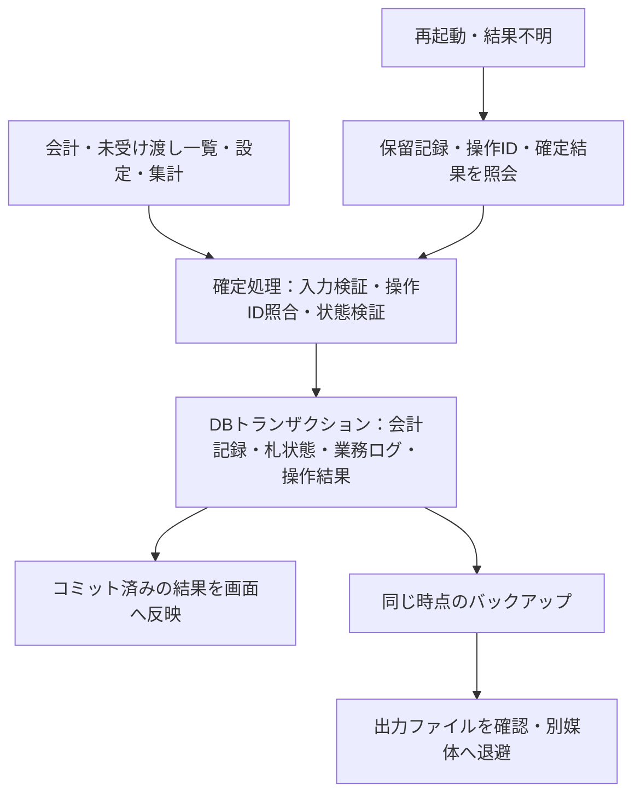

# 焼き鳥人間 会計システム アーキテクチャ設計書

更新日：2026-10-30

状態：独立レビュー反映版。誰のPCでもブラウザから起動しやすいPWA＋IndexedDBを採用方針とする。初期版を実装し、自動試験を追加した。実機の停電・OS異常終了は未検証。操作は[運用手順](operations.md)、試験範囲は[検証範囲](acceptance.md)を参照。

## 1. 決定状況

| 項目 | 状態 |
|---|---|
| PC1台・営業中はインターネット不要 | ユーザー確認済み |
| ブラウザで会計・注文確認・集計を行う | 基本方針 |
| 初回のオンライン準備 | ユーザー確認済み |
| 単価・セット・値下げを画面で選択変更 | ユーザー確認済み。設定範囲の詳細は提案 |
| DB記録の確実性を最優先、PCの処理速度は評価しない | ユーザー確認済み |
| 起動の手軽さ | 誰のPCでも気軽に使えることを優先。OS別の保存用アプリは導入しない |
| 保存方式 | PWA＋IndexedDB／Dexie.js。下記の保存・復旧条件を検証してから本番利用する |
| データ消去・PC故障時の許容損失と紙営業 | 未合意。バックアップ頻度・別媒体・復旧手順を決める条件 |

保存・照合・復旧の契約は、独立レビューの指摘を維持する。保存用アプリ案の比較は[設計レビュー結果](design-review.md)に残し、実装はPWAへ一本化する。

## 2. 共通の構成と保存契約

画面にはReact＋TypeScript、ビルドにはViteを使う案とする。金額の見積もり、会計を確定する処理、DBへの保存、注文表示・集計を分離する。確定時の検証と保存は同じ処理経路に集約し、画面がDBを直接自由に書き換える構成を避ける。

保存先は使用PC内に置き、クラウドDB同期とオンライン認証は行わない。確定前の入力、現金を受け取った事実、DBのコミット、画面の完了表示は、それぞれ別の段階として扱う。

### 2.1 DBで守る条件

- 注文ID・操作IDは一意にする。確定記録を通常の保存経路で上書きしない。
- 注文・札状態・対応ログ・操作結果を同じトランザクションで記録し、一部だけを残さない。
- 札の空き確認と割り当ては同じトランザクション内で行う。札は一度に一つの注文・割り当てIDだけが所有する。
- 札の解放時は注文ID・割り当てID・現在の状態を検証し、古い完了操作で次の注文の札を解放しない。
- 価格設定の版と変更ログは同時に保存する。金額は整数の円単位で、数量・合計・お預かり金額・お釣りの整合を検証する。
- 取消・返金は元会計に関連付けて追記し、累積返金額や減らす本数が元の記録を超えないようにする。
- ログにはトランザクション内で採番する連番を持たせ、追跡順をPCの時計だけに依存させない。
- 全更新操作は期待するDB識別子・世代をトランザクション内で検証する。不一致なら、手動再試行を含め更新を拒否する。

画面で二重操作を防ぐことに加え、保存処理でもキー制約と状態の検証を行う。二重起動の抑止が破れた場合にも不整合を作らないことを検証する。

## 3. PWA＋IndexedDB

事前にオンラインでPWAを準備し、アプリ本体をService WorkerとCache Storageへ保存する。価格計算と確定処理はTypeScript、保存処理はDexie.js＋IndexedDBとする。

配布先にはFirebase Hostingの無料枠による静的配信を候補とする。配信元へ注文・費用・バックアップを送信しない。画面・画像・フォントを事前に取得し、営業中に外部APIやCDNを使わないと動かない構成にしない。

重要な書き込みではIndexedDBの `durability: "strict"` を要求する方式を検証する。これは耐久性を優先するためのブラウザへの要求であり、媒体故障や停電に対する無条件の保証ではない。採用したDexie.jsから実際のトランザクションへ設定が伝わるかを実機で確認する。

Dexie.jsの設定によってはコミット前に変更が画面へ反映される。会計・札状態・完了表示で楽観的更新を使わず、キャッシュの無効化などで、未コミットの状態を保存済みと表示しない構成を検証する。

データはURLのオリジンとブラウザのプロファイルに結び付く。同じ通常プロファイルを使用し、プライベートモードで営業しない。永続ストレージを要求するが、利用者による削除やPC故障への対策にはならない。要求が承認されない場合に営業してよいかも本番前に判断する。

## 4. 配布と起動の条件

Webへデプロイし、利用者は使用するPCで公開URLを開く。ブラウザが画面・プログラム・素材を保存し、準備完了後はオフラインで起動する。ホーム画面等へのアイコン追加は任意とし、OS別のインストーラーや保存用プログラムの手動導入は求めない。

対応ブラウザで保存機能を確認する。PCを替えてURLを開くことと、既存の売上データが引き継がれることは別である。別PCではアプリの準備とバックアップの復元を行い、件数と未解決操作を確認してから営業を再開する。

## 5. 画面と可変価格

会計入力と未受け渡し一覧を同時に確認できる構成を提案する。受け渡し操作で別の入力中注文のID・数量・価格・お預かり金額を変更しない。完了操作の対象は一覧の位置や札番号だけにせず、注文IDと割り当てIDで固定する。

価格設定の初期範囲は、3種類共通の単価、セット本数・価格、セット自動適用の有効・無効、混在可否、通常・値下げ・カスタム等のプリセットとする。通常150円・5本600円、値下げ50円・セット無効を初期候補とし、運用時の設定を確認する。汎用的なクーポンや割引の重ね掛けは初期要件に追加しない。

価格を固定する時点の提案は、最初に商品を入力したときとする。空の会計欄は最新設定を使い、入力開始後は設定の版を保持する。明示的な再計算では旧額・新額を表示し、お預かり金額とお釣りを再確認する。入金後や保存結果が不明な会計を、そのまま価格変更して再送しない。

自動適用では単品合計より安くなる場合にセットを使う。単価50円で5本600円の設定が残っても、5本の合計を250円から600円へ増やさない。種類混在なら合計本数、同じ種類だけなら種類ごとの本数で判定する。金額の内訳と適用設定を表示する。

注文には商品名、数量、価格の版とスナップショット、内訳、合計を保存する。過去の売上は現在の設定から再計算しない。各営業日の開始時には価格を確認し、前日の値下げ設定で誤って営業を始めないようにする。

## 6. 会計の状態と結果照合

### 6.1 入金前の保留保存

入金前に空き札を検証・仮確保し、注文ID、確定操作のID、商品・数量・提示価格をDBに保留記録として残す。この保存が成功するまで、通常の入金操作へ進ませない。保留だけでは売上に計上せず、結果不明の保留を再起動や時間切れだけで破棄しない。

この段階を置くことで、再起動後に入力内容とIDを照会できるようにする。DBと現金の移動を同じトランザクションにはできないため、保留の入金有無は必要に応じて担当者が現金と照合する。

### 6.2 確定と再試行

入金確認後、共通の保存契約に従って会計を確定する。会計・ログ・操作結果をコミットしてから完了を表示する。個別の書き込み要求が成功しただけでは完了扱いしない。

同じ操作ID・同じ内容なら、既に確定した結果を返す。同じ操作IDで異なる内容なら拒否する。この規則は会計だけでなく、受け渡し、札回収、取消・返金、価格変更にも適用する。各操作のID・対象・入力・DB世代は実行前に保留保存し、結果と保留の解決も同じ確定トランザクションで記録する。再試行で新しいIDを作ったり確定記録を上書きしたりしない。

### 6.3 保存結果が不明な場合

保存成功、確認できた保存失敗、結果照合待ちを分ける。コミット後に応答や画面更新だけが失敗した場合は、同じIDでDBを照会してから判断する。新規注文としての再入力や現金の再受領を促さない。

再起動時には保留、直近の確定結果、札状態を確認できる復旧表示を設ける。DBの照会自体ができない場合は結果照合待ちを維持し、紙控え等と照合する。DBへの書き込みができないときは、エラーログも同じDBへ確実に保存できるとは案内しない。

## 7. 札・取消・紙の記録

商品を渡した事実と実物の札を回収した事実を分ける。商品を渡しても札が未回収・紛失なら、その番号を再利用しない。札を解放するときは現在の注文IDと割り当てIDを確認し、古い注文の完了操作で新しい割り当てを変更しない。

満札は現金を受け取る前に知らせ、通常の入金へ進ませない。満札時の待機・受付停止・例外対応、紛失札の扱いは担当者との確認事項とする。

取消・返金は元会計を残して追記する。セットの一部を返す場合の額を、現在単価や機械的な均等割りから勝手に決めない。部分返金を初期版で扱うか、返金額と販売本数をどう調整するかを先に決める。同じ返金操作を二度反映しないことは保存側で保証する設計にする。

紙で営業を続ける場合は、紙の照合用番号、営業日、当時の価格・本数、入金・受け渡し状態を保持して復旧入力する手順を用意する。既存DBの結果不明の注文と照合し、現金を再度受け取る通常会計や、札の新規割り当てとして扱わない。復旧入力を用意しない場合は、紙で営業を継続し後で全件戻せるとは案内しない。

## 8. 保存するデータと業務ログ

| データ | 主な内容 |
|---|---|
| DB・開催回・営業日 | DB識別子、復元世代、開催回、営業日の区分 |
| 商品・価格設定 | 商品名、プリセット、設定の版、変更履歴 |
| 保留・操作結果 | 永続的な注文ID・操作ID、入力、照合状態、確定済みの結果 |
| 注文 | 一意なID、札番号、商品別数量、価格スナップショット、合計、受領金額、お釣り |
| 受け渡し・札状態 | 注文ID、割り当てID、受け渡し状態、実物札の回収状態 |
| 取消・返金 | 対象注文、操作ID、理由、調整金額と本数 |
| 業務ログ | 操作ID、ログ連番、対象、日時、関連する価格の版と記録内容 |
| 費用 | 初期費用等。利益表示を採用する場合に追加 |

業務ログはデバッグ出力で済ませずDBに保存し、通常操作から上書き・削除しない。PCを管理できる人による直接変更まで防ぐ監査証跡とは扱わない。売上は確定した会計と調整記録から再集計できるようにする。

## 9. バックアップと復元

### 9.1 整合したバックアップ

注文、札、保留、設定、操作結果、業務ログを同じ時点の状態で出力する。全対象ストアを同じIndexedDBのreadonlyトランザクションで読み出し、取得完了後にファイル化する。

バックアップには形式版、DB識別子、対象の開催回・営業日、出力日時、各件数、確定ログの連番上限を含める。ファイルを読み直して整合性と件数を検証する。JSONは復元用、CSVは集計用とし、CSVだけを完全な復元の代わりにしない。

ファイル生成・ダウンロード開始、保存先でのファイル確認、別媒体への退避を区別する。確認できていない退避を成功済みと表示しない。同じPC内の別フォルダへのコピーだけでは、PC故障への備えにならない。

### 9.2 中断しても元データを残す復元

ファイル全体を解析・検証し、会計や設定変更を止めて復元する。既存状態の退避ファイルを確認してから反映し、途中で止まっても旧状態か完全な復元状態を保持する。先に元DBを削除して分割投入する方式は採らない。

同じDBの全対象ストアを一つのIndexedDBのwriteトランザクションで置き換える方式を第一候補とする。実装時には停止・容量不足を各段階へ注入して検証する。

復元データと新しいDB世代は、同じトランザクション等で原子的に反映する。データの置き換えと世代更新を別々にコミットしない。古い画面や復元前の保留操作は、世代の不一致で手動再試行も含め拒否する。復元した保留は照合対象として表示し、入金済みや未入金を自動推定しない。複数PCの会計データの自動マージは初期版に含めない。

## 10. 起動・更新・営業日の切り替え

初回準備と既存営業の再開を分ける。DBがない場合は、新規準備か復元を明示的に選ぶ画面に留め、空DBを自動作成して営業再開と扱わない。営業前に開催回・営業日・適用価格・確定件数・直近の記録・未解決操作を確認する。

日付変更や新日開始だけで、未完了注文・未回収札を初期化しない。前日の未解決分を表示し、引き継ぐか取消等で処理するかは現場で判断する。

アプリ更新は営業後に検証済みのバックアップを取ってから行う。営業中の強制再読み込みはしない。DB移行に版を付け、失敗した移行を隠して空DBへ切り替えない。PWAでは初回取得・キャッシュ・DB準備の完了を表示し、通信を切って起動を検証する。

## 11. 障害ごとの合格条件

| 状況 | 合格条件・残る判断 |
|---|---|
| 保存前・保存途中に停止 | 注文・札・ログ・操作結果が全部確定するか全部未反映。再開時に保留を照合できる |
| コミット後・完了表示前に停止 | 同じIDで既存結果へ戻れ、注文・売上・返金等が重複しない |
| 通常のアプリ終了・再起動 | 保存済みの記録、保留、現在の札状態を再確認できる |
| OS異常終了・停電 | 耐久性設定を明示し、検証対象の停止条件では保存完了済み記録の欠落0を採用基準とする。欠落した方式は合格にしない。試験できない条件は未検証とし、アプリ停止試験とは分けて範囲を記録する |
| ブラウザデータ消去・PC故障 | 最後に確認済みの別媒体バックアップから復元。許容損失と紙営業の可否は未合意で本番前に決める |
| バックアップ中の会計・受け渡し | 復元後も注文・札・ログ・件数・売上が同じ時点で一致する |
| 復元中の停止・容量不足 | 元の状態か完全な復元状態が残り、途中状態で営業を再開しない |

必須の受入確認には、同じIDで異なる入力の拒否、札再利用後の古い操作、返金の再試行、空DBでの再開抑止、価格変更の境界、2日目の未解決引き継ぎを含める。保存・復元中の失敗を各書き込み箇所に入れ、画面でエラーを表示するだけでなく記録の整合を確認する。

DBの種類にかかわらず、端末故障・誤削除・バックアップ以降の記録の消失を無条件に防げるとは扱わない。以上は本番の受入条件であり、自動試験の合格だけで全条件の検証済みとは扱わない。実装済みの試験と未検証の条件は[検証範囲](acceptance.md)で管理する。

## 12. 初期版の範囲と次の判断

最初の対象は、3商品の数量入力、可変価格、お釣り、保存・結果照合、番号札・受け渡し、本数・売上、必要な取消処理、バックアップ・復元とする案。利益表示、商品編集の一般化、複数開催回を管理する高度な画面は追加候補とし、保存の検証前に範囲を広げない。

PWAとIndexedDBによる保存・結果照合・復元の初期版と自動試験を実装した。次の作業は利用するPCでの受入条件の検証。データ消去・PC故障時に許容する損失と紙営業の条件は、引き続き本番前に確認する。保存条件を満たさない場合は本番利用へ進まず、対応を相談する。

## 13. 関連資料

- [要件定義書](requirements.md)
- [設計レビュー結果](design-review.md)
- [IndexedDBのトランザクション仕様](https://www.w3.org/TR/IndexedDB/#transaction-concept)
- [IndexedDBの耐久性設定](https://developer.mozilla.org/en-US/docs/Web/API/IDBDatabase/transaction)
- [ストレージの永続化と削除](https://storage.spec.whatwg.org/)
- [Dexie.jsのコミット完了判定](https://dexie.org/docs/Dexie/Dexie.transaction())
- [Dexie.jsの耐久性・キャッシュ設定](https://dexie.org/docs/Dexie/Dexie)

## 14. 実装の責務分離

注文の状態遷移と価格計算は`domain/`、コマンド処理と保存ポート・バックアップ検証は`application/`、Dexieの具体実装は`storage/`へ配置した。画面は`Cashier`ポートを使い、`bootstrap.ts`で実装を組み立てる。注文の状態遷移へは時刻を渡し、アプリケーションのID生成と時計も外側から渡す。

同一トランザクション内での札所有権確認・会計・ログ・操作結果の保存契約は、依存を分離しても維持する。変更時のルールは[CONTRIBUTING.md](../CONTRIBUTING.md)に記載する。
