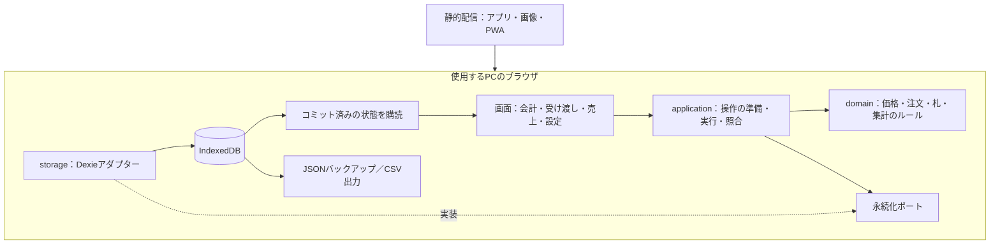

# 全体アーキテクチャ

更新日：2026-10-31

PC1台で使うオフライン対応のWebアプリです。React・TypeScript・Viteで画面を作り、業務処理も保存もブラウザ内で実行します。サーバー側のAPI・DB・認証はありません。

## 構成

配信は初回準備とアプリ更新に使用します。Cloudflare Pagesで`dist/`を配信し、サーバー側の実行処理やDBは追加しません。公開・更新は[配信手順](deployment.md)を参照してください。営業中に注文や経費を配信元へ送信する処理はありません。

## 責務と依存

| 場所 | 責務 |
|---|---|
| `src/components/`、`src/App.tsx` | 表示、入力状態、画面切り替え。操作は`Cashier`ポートへ渡す |
| `src/presentation/` | 金額・日時の表示形式 |
| `src/application/` | 操作の準備・実行・照合、保存ポート、バックアップの整合性検証 |
| `src/domain/` | 型・入力制約、価格計算、注文の状態遷移、札の取消条件、売上集計 |
| `src/storage/` | IndexedDBのトランザクション、DB定義、保存・復元 |
| `src/bootstrap.ts` | DB・ID生成・時刻・購読を接続する組み立て場所 |

DDDとクリーンアーキテクチャの考え方に沿い、依存を内側へ向けます。domainはReact・Dexieを参照せず、applicationは保存先の具体実装を参照しません。画面もDBを直接更新しません。詳細は[フロントエンド](frontend.md)と[バックエンド相当の処理](backend.md)を参照してください。

## 会計のデータフロー

1. 商品を最初に入力した時点の価格を、画面の下書きへ固定する。
2. 「会計へ」で注文と札割り当てを保存する。この時点では未入金で、売上に含めない。
3. お預かり金額を入力し、確定する操作を先に保存する。
4. 現金を確認して会計を確定する。保存時に金額・札の所有者・DB世代を検証する。
5. 注文・札・操作結果・連番ログを同時に保存し、成功後に画面へ反映する。

受け渡しと札回収も一度の操作で保存します。完了の取り消しは、対象の札が次の注文に一度も再利用されていない場合に限ります。操作や価格の履歴は残します。

## データの識別

| 識別子 | 用途 |
|---|---|
| 注文ID | 一つの注文を一意に識別。再利用しない |
| 札番号 | 実物の番号札。回収後に再利用する |
| 割り当てID | 札をその注文へ渡した一回の割り当てを識別 |
| 操作ID | 保存・再試行・結果照合を同じ処理として扱う |
| DB識別子・復元世代 | 保存先の取り違えと、復元前の古い操作を防ぐ |
| ログ連番 | PCの時計とは別に、保存された操作順を示す |

同じ操作ID・同じ内容の再試行は既存結果を返します。同じIDで内容を変えた操作、古い世代、別注文が所有する札への操作は拒否します。画面の連打防止やWeb Locksによる二重起動抑止に加え、保存層でも検証します。

## 価格と過去の記録

商品ごとにID・名前・通常価格・値下げ価格を持ちます。セットは対象商品・本数・価格を設定し、対象商品を組合せ自由でまとめた最安額を計算します。単品合計より高くなるセットは使いません。

注文には商品名・数量・価格設定・計算結果を保存します。商品を削除したり価格を変えたりしても、入力中・会計済みの記録は当時の内容を保持します。旧形式の価格は互換処理で読み、保存済み記録を書き換えて新形式に揃える方式は使いません。

## オフライン・保存・復元

- Service Workerがアプリ本体を保存し、IndexedDBが業務データを保持する。開発サーバーではPWAキャッシュを有効にしない。
- Dexieは`cache: 'disabled'`と`chromeTransactionDurability: 'strict'`を指定する。コミット前の状態を保存済みとして表示しない。
- データはURLのオリジンとブラウザのプロファイルに結び付く。別PCへはJSONバックアップで引き継ぐ。
- JSONは全ストアの同じ時点を取得する。復元は整合性と退避を確認し、全データと新しい世代を一括で反映する。
- 更新はバックアップ確認後、入力中・保留の操作を解消してから行う。

strict指定や永続ストレージの要求は、ブラウザデータの削除・停電・PC故障への無条件の保証ではありません。本番利用前の実機確認とバックアップ運用は[検証範囲](acceptance.md)・[運用手順](operations.md)にまとめています。
